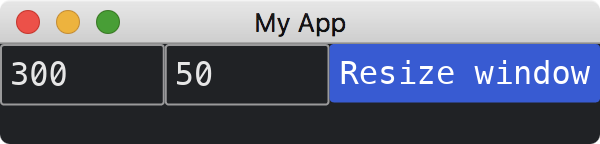

# Changing The Window Dynamically

We can use functions provided in [window](https://docs.rs/iced/0.13.1/iced/window/index.html) module to change the window after it is initialized.

For example, the [resize](https://docs.rs/iced/0.13.1/iced/window/fn.resize.html) function of the window
returns a task that can be used as the return value in the `update` method. There are many other functions that return tasks in the [window](https://docs.rs/iced/0.13.1/iced/window/index.html) module.

The [resize](https://docs.rs/iced/0.13.1/iced/window/fn.resize.html) function needs an ID of the window we are going to resize. To do that, the window module has a [`get_latest`](https://docs.rs/iced/0.13.1/iced/window/fn.get_latest.html) function. This function also returns a task that needs to be resolved to the Id of the latest window. In our case, since we have a single window, it will always return the Id of the main window.

```rust
use iced::{
    Element, Result, Size, Task,
    widget::{button, row, text_input},
    window,
};

fn main() -> Result {
    iced::application("My App", MyApp::update, MyApp::view).run_with(MyApp::new)
}

#[derive(Debug, Clone)]
enum Message {
    UpdateWidth(String),
    UpdateHeight(String),
    ResizeWindow,
}

struct MyApp {
    width: String,
    height: String,
}

impl MyApp {
    fn new() -> (Self, Task<Message>) {
        (
            Self {
                width: "1024".into(),
                height: "768".into(),
            },
            Task::none(),
        )
    }

    fn resize_window(width: f32, height: f32) -> impl Fn(window::Id) -> Task<Message> {
        move |window_id: window::Id| {
            println!("Calling resize_window");
            window::resize::<Message>(window_id, Size::new(width, height))
        }
    }

    fn update(&mut self, message: Message) -> Task<Message> {
        match message {
            Message::UpdateWidth(w) => self.width = w,
            Message::UpdateHeight(h) => self.height = h,
            Message::ResizeWindow => {
                let width = self.width.parse::<f32>().unwrap_or(1024.0);
                let height = self.height.parse::<f32>().unwrap_or(768.0);
                println!("Resizing window to {}x{}", width, height);
                return window::get_latest().and_then(Self::resize_window(width, height));
            }
        }
        Task::none()
    }

    fn view(&self) -> Element<Message> {
        row![
            text_input("Width", &self.width).on_input(Message::UpdateWidth),
            text_input("Height", &self.height).on_input(Message::UpdateHeight),
            button("Resize window").on_press(Message::ResizeWindow),
        ]
        .into()
    }
}
```



Another example is to resize the window to the monitor size.
It first obtains the size of the monitor by [monitor_size](https://docs.rs/iced/latest/iced/window/fn.monitor_size.html), and then passes the size to `resize_window`.
To do so, change the previous example as follows.

Add `ResizeToMonitorSize` to `Message`.

```rust
#[derive(Debug, Clone)]
enum Message {
    UpdateWidth(String),
    UpdateHeight(String),
    ResizeWindow,
    ResizeToMonitorSize,
}
```

Add the code for `Message::ResizeToMonitorSize`.

```rust
fn update(&mut self, message: Message) -> Task<Message> {
    match message {
        Message::UpdateWidth(w) => /* ... */,
        Message::UpdateHeight(h) => /* ... */,
        Message::ResizeWindow => { /* ... */ }
        Message::ResizeToMonitorSize => {
            return window::latest().and_then(|id| {
                window::monitor_size(id).and_then(move |size| {
                    Self::resize_window(size.width, size.height)(id)
                })
            });
        }
    }
    Task::none()
}
```

Add a button to deliver `Message::ResizeToMonitorSize`.

```rust
fn view(&self) -> Element<Message> {
    row![
        text_input("Width", &self.width).on_input(Message::UpdateWidth),
        text_input("Height", &self.height).on_input(Message::UpdateHeight),
        button("Resize window").on_press(Message::ResizeWindow),
        button("Resize to monitor size").on_press(Message::ResizeToMonitorSize),
    ]
    .into()
}
```

By pressing button `Resize to monitor size`, the window resizes to the monitor size.

:arrow_right:  Next: [Closing The Window On Demand](./closing_the_window_on_demand.md)

:blue_book: Back: [Table of contents](./../README.md)
